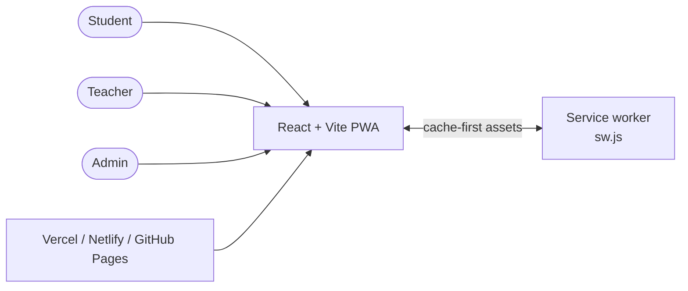

# EduGameHub: High-Level Design

A gamified STEM learning platform for rural students in grades 6–12: role-based dashboards for students, teachers and admins, game-style quizzes with XP, three languages, an offline-capable PWA and a lite mode for low-end devices. Live at [edugamiz.vercel.app](https://edugamiz.vercel.app). For code-level detail see the [Low-Level Design](lld.md).

## 1. Context

The current build is front-end only: users sign in with demo accounts and progress lives in app state.

## 2. Components

| Component | Responsibility |
|---|---|
| Login screen | Role choice and demo sign-in (student, teacher, admin) |
| Student dashboard | Subjects, progress, start a game |
| Teacher dashboard | Class overview and student progress |
| Admin dashboard | Platform overview |
| `PokemonGame` | Quiz game per subject with score and XP |
| Compatibility / Troubleshoot modules | Device checks and help for low-end phones, in every dashboard |
| Offline status, language toggle, lite mode | Accessibility for rural connectivity |

## 3. Design for rural classrooms

| Need | Approach |
|---|---|
| Patchy internet | PWA manifest + service worker cache (`edugamehub-v1.0.0`), offline banner |
| Local languages | English, Hindi, Punjabi |
| Low-end devices | Lite mode (fewer effects) and a compatibility checker |
| Engagement | Game-based quizzes, XP and scores |

## 4. Tech

| Item | Choice |
|---|---|
| UI | React + TypeScript, Vite, Tailwind CSS, shadcn/ui (Radix) |
| Offline | Service worker + web manifest |
| Deploy | Scripts and configs for Vercel, Netlify and GitHub Pages |
