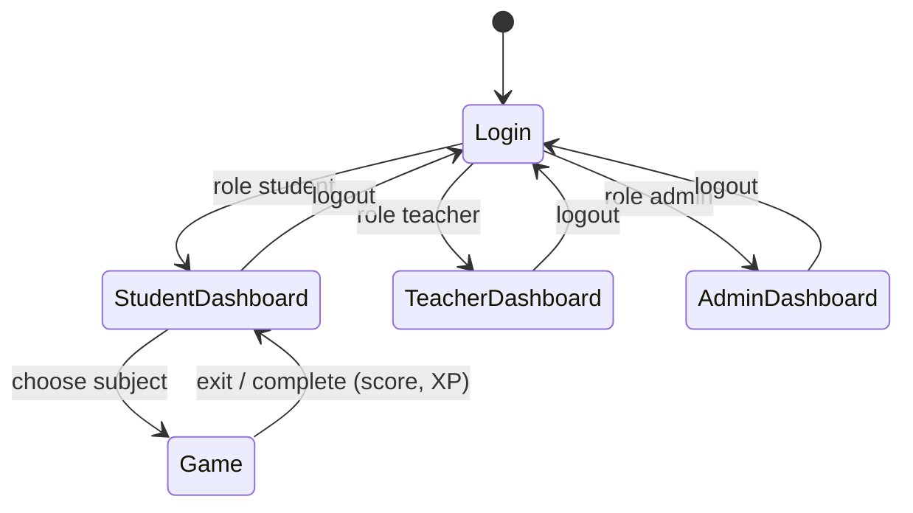
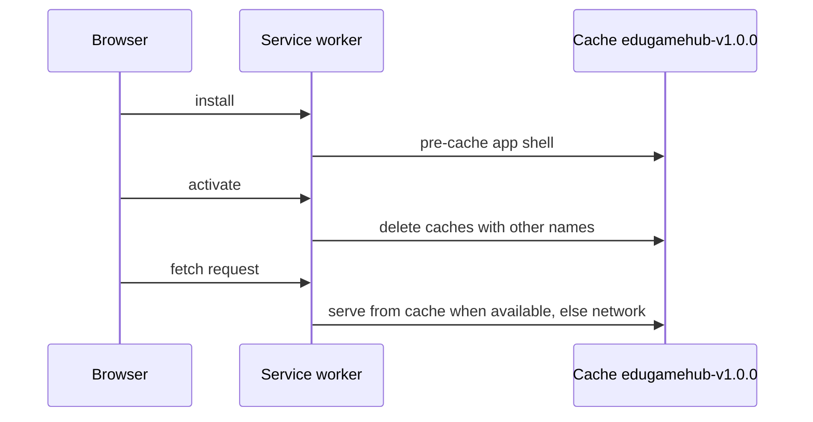

# EduGameHub: Low-Level Design

For the big picture see the [High-Level Design](hld.md).

## 1. App state (`src/App.tsx`)

| State | Type | Purpose |
|---|---|---|
| `isAuthenticated`, `currentUser` | bool, `User` | Session |
| `userRole` | student / teacher / admin | Which dashboard to render |
| `language` | `en`, `hi`, `pa` | UI strings from the `translations` objects |
| `theme` | light / dark | Theme |
| `isLiteMode` | bool | Fewer animations for slow devices |
| `isOffline` | bool | From `navigator.onLine` and online / offline events |
| `currentGame`, `gameActive` | | Game in progress |

## 2. Screen flow

## 3. Demo accounts

| Role | Username / password |
|---|---|
| Student | `student` / `demo123` |
| Teacher | `teacher` / `demo123` |
| Admin | `admin` / `demo123` |

## 4. Offline caching (`public/sw.js`)

## 5. Notes

`GameInterface` and `QuestionBank` exist but are not mounted (the app uses `PokemonGame`). The repo has both a root Vite setup and a copy under `src/` (with its own `package.json`, `vite.config.ts` and deploy scripts); keeping one would simplify builds.
